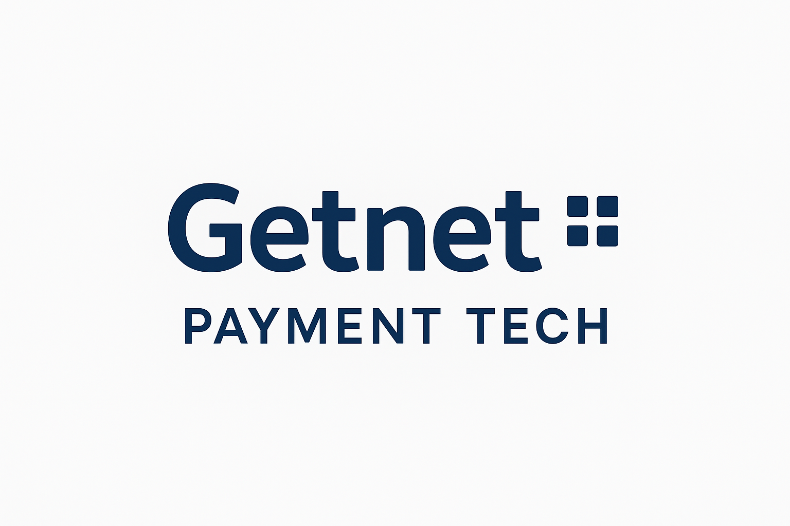

# getnet_payment_tech

> Open source Flutter plugin for Getnet Android POS terminals: credit, debit, voucher, PIX, refund, pre-authorization, status, reprint and printing through the Getnet deep links and the libposdigital SDK.

[](https://pub.dev/packages/getnet_payment_tech)
[](LICENSE)

<div align="center">
  
</div>

Plugin Flutter para integrar o seu app aos terminais Smart POS Android da **Getnet**. As operações de pagamento abrem o app de pagamento da Getnet por deep link (`getnet://pagamento/...`) e a impressão usa o SDK `libposdigital`. Gratuito e open source, sob a licença MIT.

> **Plugin não oficial.** Foi desenvolvido de forma independente pela JY Labtech e não tem vínculo com a Getnet.

## Índice

- [Funcionalidades](#funcionalidades)
- [Terminais e requisitos](#terminais-e-requisitos)
- [Instalação](#instalação)
- [Configuração Android](#configuração-android)
- [Uso rápido](#uso-rápido)
- [Referência da API](#referência-da-api)
- [Exemplos por operação](#exemplos-por-operação)
- [Tratamento de erros](#tratamento-de-erros)
- [App de exemplo](#app-de-exemplo)
- [Testes](#testes)
- [Migração da 1.x para a 2.0](#migração-da-1x-para-a-20)
- [Contribuindo](#contribuindo)
- [Licença](#licença)
- [Créditos](#créditos)

## Funcionalidades

| Operação | Método | Canal nativo | Deep link Getnet |
| --- | --- | --- | --- |
| Crédito à vista | `creditPayment` | `payment` | `getnet://pagamento/v3/payment` |
| Crédito parcelado | `creditPaymentParc` | `paymentCreditParc` | `getnet://pagamento/v3/payment` |
| Débito | `debitPayment` | `payment` | `getnet://pagamento/v3/payment` |
| Voucher | `voucherPayment` | `payment` | `getnet://pagamento/v3/payment` |
| PIX | `pixPayment` | `payment` | `getnet://pagamento/v3/payment` |
| Estorno | `refundPayment` | `refundPayment` | `getnet://pagamento/v1/refund` |
| Pré-autorização | `preAuthorization` | `preAuthorization` | `getnet://pagamento/v2/pre-authorization` |
| Consulta de status | `paymentStatus` | `statusPayment` | `getnet://pagamento/v1/checkstatus` |
| Reimpressão do último comprovante | `reprint` | `reprint` | `getnet://pagamento/v1/reprint` |
| Informações do terminal | `getInfo` | `info` | `getnet://pagamento/v1/getinfos` |
| Dados do aparelho | `getDeviceInfo` / `getDeviceInfoData` | `deviceInfo` | (local, sem deep link) |
| Impressão de texto e imagem | `print` | `print` | (SDK `libposdigital`) |

## Terminais e requisitos

- **Terminais:** Smart POS Android da Getnet com o **app de pagamento da Getnet** instalado (é ele que atende os deep links `getnet://pagamento`).
- **SDK:** `libposdigital-1.8.1-13-release.aar` (SDK da Getnet). O AAR vem dentro do pacote, em `android/libs/`, e precisa ser adicionado ao app (veja [Configuração Android](#configuração-android)).
- **Android:** `minSdk 22`; o plugin compila com `compileSdk 36` e Java 11.
- **Flutter:** `>= 3.3.0`. **Dart:** `^3.9.2`.
- **Plataformas:** somente Android.
- **Permissões:** o plugin não declara permissões no Manifest e não faz acesso à rede.

## Instalação

```bash
flutter pub add getnet_payment_tech
```

Ou, no `pubspec.yaml`:

```yaml
dependencies:
  getnet_payment_tech: ^2.0.0
```

## Configuração Android

### 1. SDK da Getnet (`libposdigital`)

O plugin compila contra o `libposdigital`, mas um plugin Android não consegue embutir um AAR local no app. Copie o AAR para o seu app e declare a dependência.

1. Copie `libposdigital-1.8.1-13-release.aar` para `android/app/libs/` do seu app. O arquivo está no pacote baixado pelo `pub` (por exemplo, `~/.pub-cache/hosted/pub.dev/getnet_payment_tech-2.0.0/android/libs/`) e também em [`example/android/app/libs/`](example/android/app/libs/).
2. No `android/app/build.gradle.kts`:

```kotlin
repositories {
    flatDir {
        dirs("libs")
    }
}

dependencies {
    implementation(files("libs/libposdigital-1.8.1-13-release.aar"))
}
```

Com Groovy (`android/app/build.gradle`):

```groovy
dependencies {
    implementation files('libs/libposdigital-1.8.1-13-release.aar')
}
```

Sem o AAR, o app não fecha: todas as chamadas respondem `PlatformException(code: 'NATIVE_UNAVAILABLE')` com a causa na mensagem.

### 2. `minSdk`

Garanta `minSdk = 22` ou maior em `android/app/build.gradle.kts`.

### 3. Activity

O plugin usa a Activity do Flutter para abrir os deep links (`startActivityForResult`) e receber o resultado. A `MainActivity` padrão (`FlutterActivity`) já funciona; não é preciso alterar o Manifest nem declarar intent filters. O plugin só consome os resultados dos seus próprios requestCodes (10001 a 10006); resultados de outras Activities seguem para os demais plugins.

## Uso rápido

```dart
import 'dart:convert';

import 'package:flutter/material.dart';
import 'package:getnet_payment_tech/getnet_payment_tech.dart';

class Checkout implements IGetnetHandler {
  @override
  Future<void> onFinishedResponse(String message) async {
    // JSON: {"code": "SUCCESS" | "PENDING", "data": {...}}
    final json = jsonDecode(message) as Map<String, dynamic>;
    final data = (json['data'] as Map?)?.cast<String, dynamic>() ?? json;
    final transaction = GetnetTransactionModel.fromMap(data);
    debugPrint('Aprovada: ${transaction.isApproved} NSU: ${transaction.nsu}');
  }

  @override
  Future<void> onError(String message) async => debugPrint('Erro: $message');

  @override
  Future<void> onTransactionSuccess() async {}

  @override
  Future<void> onMessage(String message) async {}

  @override
  Future<void> onChanged(String message) async {}

  @override
  Future<void> onLoading(bool show) async {}
}

Future<void> main() async {
  WidgetsFlutterBinding.ensureInitialized();
  runApp(const MaterialApp(home: PayButton()));
}

class PayButton extends StatelessWidget {
  const PayButton({super.key});

  Future<void> _pay() async {
    final payment = await GetnetTech.I.initPayment(handler: Checkout());
    final ok = await payment.creditPayment(
      amount: 25.90,
      callerId: DateTime.now().millisecondsSinceEpoch.toString(),
      orderId: 'PEDIDO-123',
    );
    debugPrint(ok ? 'Pagamento concluído' : 'Pagamento não concluído');
  }

  @override
  Widget build(BuildContext context) {
    return Scaffold(
      body: Center(
        child: ElevatedButton(onPressed: _pay, child: const Text('Pagar R\$ 25,90')),
      ),
    );
  }
}
```

## Referência da API

Tudo é exportado por `package:getnet_payment_tech/getnet_payment_tech.dart`.

### `GetnetTech`

| Membro | Descrição |
| --- | --- |
| `static GetnetTech get I` | Instância única, ligada ao canal `getnet_payment_tech`. |
| `GetnetTech(MethodChannel channel)` | Construtor para injetar outro canal (útil em testes). |
| `static const channelName` | `"getnet_payment_tech"`. |
| `Future<Payment> initPayment({required IGetnetHandler handler})` | Registra o handler e confirma que o nativo está carregado. Chamadas seguintes só trocam o handler. Lança `PlatformException` (ex.: `NATIVE_UNAVAILABLE`, `UNAVAILABLE`) se o nativo ou a Activity não estiverem disponíveis. |
| `Payment get payment` | O `Payment` criado pelo `initPayment`. Lança uma `String` de erro se o `initPayment` ainda não terminou com sucesso. |

```dart
final payment = await GetnetTech.I.initPayment(handler: myHandler);
// depois, em qualquer lugar:
await GetnetTech.I.payment.reprint();
```

### `Payment`

Todos os métodos (exceto `getDeviceInfoData`) retornam `Future<bool>`: `true` quando a operação terminou com sucesso (para deep links, `code` `SUCCESS` ou `PENDING` no retorno do app da Getnet) e `false` em qualquer erro (cancelamento, recusa, falha ao abrir o deep link). O detalhe chega ao handler (`onFinishedResponse` ou `onError`). Os valores são em reais (`double`) e o plugin envia ao SDK em centavos, com 12 dígitos (`25.90` vira `"000000002590"`), moeda 986 (BRL).

| Método | Parâmetros | Observações |
| --- | --- | --- |
| `creditPayment` | `required double amount`, `required String callerId`, `required String orderId`, `bool allowPrintCurrentTransaction = false` | Crédito à vista. |
| `creditPaymentParc` | `amount`, `callerId`, `orderId`, `required int installments`, `allowPrintCurrentTransaction` | Crédito parcelado em `installments` vezes. |
| `debitPayment` | `amount`, `callerId`, `orderId`, `allowPrintCurrentTransaction` | Débito. |
| `voucherPayment` | `amount`, `callerId`, `orderId`, `allowPrintCurrentTransaction` | Voucher (alimentação/refeição). |
| `pixPayment` | `amount`, `callerId`, `orderId`, `allowPrintCurrentTransaction` | PIX. |
| `refundPayment` | `required double amount`, `required String callerId`, `required String transactionDate`, `required String cvNumber`, `String? originTerminal`, `allowPrintCurrentTransaction` | Estorno. `transactionDate` no formato `DDMMAAAA`; `cvNumber` da transação original. |
| `preAuthorization` | `amount`, `callerId`, `orderId`, `allowPrintCurrentTransaction` | Pré-autorização. |
| `paymentStatus` | `required String callerId`, `allowPrintCurrentTransaction` | Consulta a transação feita com esse `callerId`. |
| `reprint` | nenhum | Reimprime o último comprovante. |
| `getInfo` | nenhum | Informações do terminal (dados chegam no `onFinishedResponse`). |
| `getDeviceInfo` | nenhum | Lê os dados do aparelho localmente e retorna só `true`/`false`. Para os dados, use `getDeviceInfoData`. |
| `getDeviceInfoData` | nenhum | Retorna `Future<Map<String, dynamic>?>` com `deviceModel` (`Build.MODEL`) e `serialNumber` (no Android 8.0+ o sistema não expõe o serial e o valor é `"Block Info"`), ou `null` em erro. Não passa pelo handler. |
| `print` | `required GetnetPrinterParams printerParams` | Imprime pelo `libposdigital`, em background (o SDK espera cerca de 5 s após iniciar a impressora); o `Future` completa quando a impressão termina. |
| `setHandler(IGetnetHandler handler)` | handler | Troca o handler sem reinicializar. |

- `callerId`: identificador único da chamada no seu app (ex.: timestamp ou UUID); use o mesmo para consultar o status.
- `orderId`: identificador do pedido.
- `allowPrintCurrentTransaction`: pede ao app da Getnet para imprimir o comprovante.

### `IGetnetHandler`

Implemente todos os métodos:

| Callback | Quando é chamado |
| --- | --- |
| `Future<void> onFinishedResponse(String message)` | Retorno com `code` `SUCCESS` ou `PENDING` de uma operação por deep link. `message` é um JSON `{"code": ..., "data": {...}}`, em que `data` traz os extras devolvidos pelo app da Getnet. |
| `Future<void> onError(String message)` | Retorno com erro de uma operação por deep link (ex.: `"Negada"`, `"Cancelada"`, `"Falha"`, com o detalhe do app da Getnet em outra linha) ou cancelamento (`"Operação cancelada ou não concluída no app da Getnet (resultCode=0)."`). |
| `Future<void> onTransactionSuccess()` | Reservado; o nativo atual não dispara. |
| `Future<void> onMessage(String message)` | Reservado; o nativo atual não dispara. |
| `Future<void> onChanged(String message)` | Reservado; o nativo atual não dispara. |
| `Future<void> onLoading(bool show)` | Reservado; o nativo atual não dispara. |

Os callbacks rodam na isolate principal; atualize a UI com `setState` ou o seu gerenciador de estado.

### Modelos

**`GetnetTransactionModel`** (todos os campos são opcionais, `String?` exceto `amount`):

| Campo | Descrição |
| --- | --- |
| `result` | Código de resultado. `isApproved` é `true` quando `result` é `'0'` ou `'00'`. |
| `resultDetails` | Detalhe do resultado. |
| `amount` (`double?`) | Valor em reais. Strings com 10 dígitos ou mais são tratadas como centavos. |
| `callerId`, `orderId` | Identificadores enviados. |
| `nsu`, `cvNumber`, `authorizationCode` | Dados da autorização (use `cvNumber` no estorno). |
| `type`, `brand`, `inputType`, `installments` | Tipo, bandeira, modo de entrada e parcelas. |
| `cardBin`, `cardLastDigits`, `cardholderName` | Dados do cartão. |
| `errorMessage`, `method`, `message` | Erro e metadados. |

Construtores: `GetnetTransactionModel.fromMap(Map<String, dynamic>)`, `.fromJson(String)`, `.toError(String message)`; também `toMap()` e `toJson()`.

**`GetnetPrinterParams`**: `text` (`String?`), `base64Image` (`String?`, PNG/JPEG em Base64) e `lines` (`int?`, linhas em branco ao final). Imprime nesta ordem: texto (alinhado à esquerda, fonte média), imagem (centralizada) e linhas em branco. `printableContent` mostra os itens enviados ao nativo.

**`GetnetResponse`**: `method`, `errorMessage`, `message` (`String?`) e `result` (`int?`), com `fromMap`/`fromJson`/`toMap`/`toJson`.

### Enums

- `PaymentTypeCall`: `payment`, `paymentCreditParc`, `paymentStatus`, `paymentRefund`, `preAuthorization`, `print`, `reprint`, `info`, `deviceInfo`. A extensão `.method` dá o nome no canal (ex.: `PaymentTypeCall.paymentStatus.method == 'statusPayment'`).
- `PaymentTypeHandler`: `onTransactionSuccess`, `onError`, `onMessage`, `onLoading`, `onFinishedResponse`, `onChanged`. A extensão `String.handler` converte o nome recebido do nativo.

## Exemplos por operação

```dart
final payment = GetnetTech.I.payment;
final callerId = DateTime.now().millisecondsSinceEpoch.toString();
```

**Crédito à vista**

```dart
await payment.creditPayment(amount: 100.00, callerId: callerId, orderId: 'P-1');
```

**Crédito parcelado (3x)**

```dart
await payment.creditPaymentParc(
  amount: 300.00,
  callerId: callerId,
  orderId: 'P-2',
  installments: 3,
);
```

**Débito**

```dart
await payment.debitPayment(amount: 50.00, callerId: callerId, orderId: 'P-3');
```

**PIX**

```dart
await payment.pixPayment(amount: 15.00, callerId: callerId, orderId: 'P-4');
```

**Voucher**

```dart
await payment.voucherPayment(amount: 32.50, callerId: callerId, orderId: 'P-5');
```

**Estorno**

```dart
await payment.refundPayment(
  amount: 100.00,
  callerId: callerId,
  transactionDate: '25122026', // DDMMAAAA da transação original
  cvNumber: lastTransaction.cvNumber!,
);
```

**Pré-autorização**

```dart
await payment.preAuthorization(amount: 200.00, callerId: callerId, orderId: 'P-6');
```

**Consulta de status**

```dart
await payment.paymentStatus(callerId: callerIdDaTransacao);
```

**Reimpressão e informações**

```dart
await payment.reprint();
await payment.getInfo();       // dados no onFinishedResponse
await payment.getDeviceInfo(); // só true/false

final device = await payment.getDeviceInfoData();
debugPrint('Modelo: ${device?['deviceModel']}');
```

**Impressão**

```dart
final ok = await payment.print(
  printerParams: GetnetPrinterParams(
    text: 'MINHA LOJA\nPedido P-1\nTotal: R\$ 100,00',
    base64Image: logoBase64, // opcional
    lines: 3,
  ),
);
```

## Tratamento de erros

Os métodos de `Payment` não lançam exceção: retornam `false` e, nas operações por deep link, chamam `onError`. Só o `initPayment` lança `PlatformException`.

| Código | Onde aparece | Significado |
| --- | --- | --- |
| `NATIVE_UNAVAILABLE` | `initPayment` e qualquer chamada | A implementação nativa ou o SDK `libposdigital` não está no app. A mensagem traz a causa. |
| `UNAVAILABLE` | `initPayment` e qualquer chamada | O plugin ainda não está ligado a uma Activity. |
| `CANCELED` | operações por deep link (`false` + `onError`) | O app da Getnet voltou sem `RESULT_OK` (usuário cancelou, voltou ou fechou). |
| `ERROR` | operações (`false` + `onError` quando há deep link) | Recusa ou falha no app da Getnet (`Negada`, `Cancelada`, `Falha`, `Desconhecido`), dados inválidos (`Invalid payment details: ...`), deep link que não abriu, ou falha de impressão (`Instance of PosDigital not initialized`, código de status da impressora). |
| `notImplemented` | qualquer chamada | Método desconhecido no canal. |

```dart
try {
  await GetnetTech.I.initPayment(handler: handler);
} on PlatformException catch (e) {
  if (e.code == 'NATIVE_UNAVAILABLE') {
    // Adicione o libposdigital ao app (veja Configuração Android).
  }
}

final ok = await GetnetTech.I.payment.debitPayment(
  amount: 10,
  callerId: callerId,
  orderId: 'P-7',
);
if (!ok) {
  // O motivo chegou em onError(message).
}
```

Cada chamada recebe exatamente uma resposta no seu próprio `Future`, mesmo que outra operação seja chamada enquanto o app da Getnet está aberto.

## App de exemplo

O diretório [`example/`](example/) tem um app com todas as operações (crédito, parcelado, débito, voucher, PIX, pré-autorização, status, reimpressão, info, device info e estorno). O AAR do SDK já está em `example/android/app/libs`.

```bash
cd example
flutter pub get
flutter run   # em um terminal POS Getnet
```

## Testes

Testes Dart (contrato do MethodChannel de todos os métodos, handler e modelos):

```bash
flutter test
```

Testes JVM do nativo (`android/native`: roteamento do `GetnetTech`, resposta única de cada usecase, regras do `onActivityResult`), com JDK 17 e o Gradle wrapper do example:

```bash
bash scripts/build_android_aar.sh   # gera android/native/local.properties e os binários em android/libs
cd example/android
./gradlew -p ../../android/native testDebugUnitTest
```

Teste da bridge Java (`android/src`), que carrega o nativo pré-compilado em `android/libs`:

```bash
cd example/android
./gradlew :getnet_payment_tech:testDebugUnitTest
```

### Binários nativos

O código nativo fica em `android/native` e é distribuído pré-compilado em `android/libs/getnet_payment_tech-native.jar` (e `.aar`). Depois de alterar o Java, regenere com:

```bash
FLUTTER_SDK=/caminho/do/flutter JAVA_TOOL_OPTIONS=-Xmx2g bash scripts/build_android_aar.sh
```

O script aceita flags extras do Gradle em `GRADLE_ARGS` (ex.: `GRADLE_ARGS="--no-daemon"`).

## Migração da 1.x para a 2.0

A 2.0 é gratuita e open source: não há mais chave de ativação nem consulta a servidor. Os parâmetros foram **removidos** da API, então o código antigo deixa de compilar até você apagá-los.

| Removido | O que fazer |
| --- | --- |
| `initPayment(licenceKey:)` | Apague o argumento. |
| `initPayment(licenceInternalKey:)` | Apague o argumento. |
| `Payment.create(licenceKey:, licenceInternalKey:)` e `ensureInitialised(licenceKey:, licenceInternalKey:)` | Apague os argumentos. |
| constante `licenceCheck` | Apague o uso. |
| erro `LICENCE_ERROR` | Não existe mais; apague o tratamento. |
| `--dart-define` com a chave | Pode ser removido do build. |

Antes (1.x):

```dart
await GetnetTech.I.initPayment(
  handler: handler,
  licenceKey: const String.fromEnvironment('GETNET_LICENCE_KEY'),
  licenceInternalKey: licenceCheck,
);
```

Depois (2.0):

```dart
await GetnetTech.I.initPayment(handler: handler);
```

Também mudou: `print` agora envia o texto e a imagem de `GetnetPrinterParams` ao nativo (antes o conteúdo não chegava à impressora). Veja o [CHANGELOG](CHANGELOG.md).

## Contribuindo

Issues e pull requests são bem-vindos em [github.com/JY-Labtech/getnet_payment_tech](https://github.com/JY-Labtech/getnet_payment_tech/issues). Antes de abrir um PR, rode `flutter analyze`, `flutter test` e os testes nativos acima; se mudar o Java em `android/native`, regenere os binários em `android/libs`.

## Licença

Código sob a licença [MIT](LICENSE). O SDK `libposdigital` (`*.aar` da Getnet) incluído para o build é da Getnet e segue os termos dela.

## Créditos

Desenvolvido e mantido pela [JY Labtech](https://jylabtech.com.br) ([GitHub](https://github.com/JY-Labtech)).
